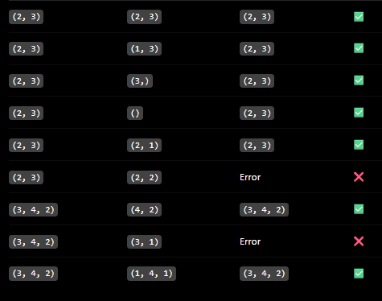
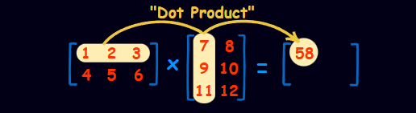
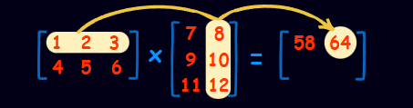
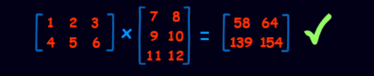

# Operations are :

## Addition (Same as Subtraction)
**`torch.add`| `torch.sub`built-in functions to add/subtract num or tensor**
**`torch.add(input, other, alpha, out)` input is the tensor, other is number or tensor, while the alpha is number i can multiply the other before adding to input `input + (other * alpha)`, finally the output is tensor optional**

## Note : Tensors must be same shape or Broadcasting
**1 - compare the shapes from right to lift**
**2 - missing dim equal 1**
**3 - broadcasting is valid when the shape of dim are equals or one of them is 1**

## Multiplication

### Element wise
**and also u can multiply with element-wise `tensor x 10` or `tensor x tensor` it's just element x element, of course must be same shape or can apply Broadcasting**

### Matrix Multiplication (Dot Product)
before getting in this let's just have a recap on **Dot Product** multiplication `(m x n) @ (n x p) = (m,p)` **which way faster than element-wise** `torch.matmul()`  
   
 
 

#### Note : if there is 2 matrixes like that (2 , 3) dot (4 , 3) usually it will cause an error but we can manipulate the matrix by `Transpose` that can just flip the shape (m , n)-> (n , m) So it will be valid the multiplication `(2 , 3) dot (3 , 4) = (2 , 4)`

## Division
**only element wise, but `A // B` will discard the fraction , but if `AX = B` and u want X use `torch.linalg.solve(A , B)` but it needs only `square matrices`**
