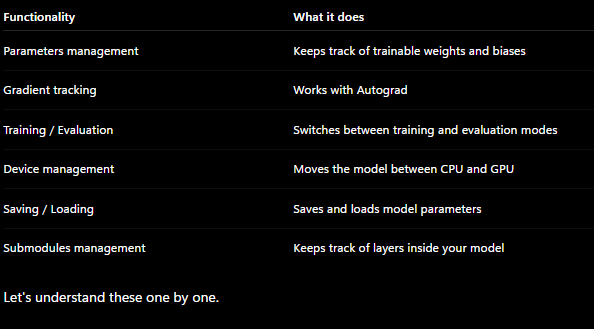

## Data 
Any type (image, DNA, text, sheets, ..etc.) 

### Preprocessing
**for images must convert all images to same size and to convert all RGB matrix or just ignore color to convert them into GrayScale**
**for sheets handling missing values, different Data types..etc.**

#### Splitting
##### `Training Set`, `Validating/Dev Set` , `Testing Set`
Most use `(60 - 80)` Train, the rest to Test 
it also can be like (60 , 20 , 20) based on how big your data is

`Train Set`: Iterative process to train the model on data, So the output is weights for each inputs, So the model with it can make predictions 

`Dev Set`: is apart of training process to choose the best **Hyper Parameters** `(Learning rate, Activation Functions, Num of layers or Hidden units)`

`Test Set` the final stage that u can't change model after it , u make the predictions and calculate the metrics for your model

so you can split data by `train_split = int(.8 * len(X))` which makes **80%** of your Train Set 

### nn.Module
**Is a base class provided by PyTorch, foundation of almost every Neural Network model you will build.**

**Why?** 
1- will have to track Parameters manually like `(Gradients, Weights, Biases)` 
2- full implement for NN logic + structure,..ETC.
*So PyTorch helps by built-in class just inherent from it and build your own neural network, CUZ imagine u have a 100*

**`torch.nn` Contains all of the building blocks for computational graphs (essentially a series of computations executed in a particular way).**

**`torch.nn.Parameter`Stores tensors that can be used with nn.Module. If requires_grad=True gradients (used for updating model parameters via gradient descent) are calculated automatically, this is often referred to as "autograd".**

**`torch.nn.Module`	The base class for all neural network modules, all the building blocks for neural networks are subclasses. If you're building a neural network in PyTorch, your models should subclass nn.Module. Requires a forward() method be implemented.**

**`torch.optim`Contains various optimization algorithms (these tell the model parameters stored in nn.Parameter how to best change to improve gradient descent and in turn reduce the loss).**

**`def forward()`	All nn.Module subclasses require a forward() method, this defines the computation that will take place on the data passed to the particular nn.Module (e.g. the linear regression formula above).**

#### Forward 
linear Regression `Z = W * X + b` 
