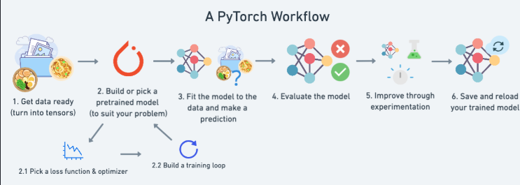

## Data 
Any type (image, DNA, text, sheets, ..etc.) 

### Preprocessing
**for images must convert all images to same size and to convert all RGB matrix or just ignore color to convert them into GrayScale**
**for sheets handling missing values, different Data types..etc.**

### Splitting
#### `Training Set`, `Validating/Dev Set` , `Testing Set`
Most use `(60 - 80)` Train, the rest to Test 
it also can be like (60 , 20 , 20) based on how big your data is

`Train Set`: Iterative process to train the model on data, So the output is weights for each inputs, So the model with it can make predictions 

`Dev Set`: is apart of training process to choose the best **Hyper Parameters** `(Learning rate, Activation Functions, Num of layers or Hidden units)`

`Test Set` the final stage that u can't change model after it , u make the predictions and calculate the metrics for your model

so you can split data by `train_split = int(.8 * len(X))` which makes **80%** of your Train Set 
