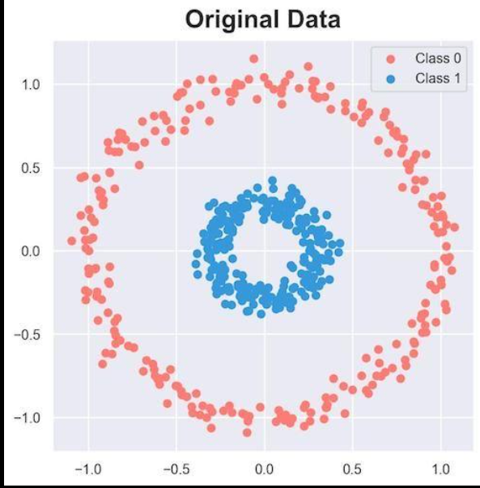

# Classification

Classification is a type of supervised learning in which a model
predicts a category (class).

**1. Binary Classification**

Binary classification involves choosing between two possible
classes, such as: `1 or 0` `True or False` `Something or Not something`

**2. Multiclass Classification**

Multiclass classification involves choosing among more than two
classes.

The model can output a probability for each class. These probabilities
add up to 1 (or 100%).

For example: `(0.1, 0.2, 0.4, 0.3)`

The predicted class is the one with the highest probability. In this
example, the third class is predicted because its probability is 0.4
(40%).

**3. Multilabel Classification**

Multilabel classification involves assigning multiple labels to a single input.
`can belong to multiple classes simultaneously.`

**Example: An image can contain:
`Cat = 1
Dog = 1
Car = 0
Person = 1`**

Each label is predicted independently, so the probabilities do not have to sum up to 1. 

1. Binary classification: we will use `sklearn.datasests` libraries such as `make_circles` to create some random data in shape of circles so we can use it in classification 

