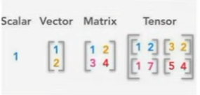

## The notebook is connected to COLAB GPU

# What is a Tensor?
**Tensor is the name for Matrix or any dimensional arrays of values**

# What is scalar?
its a single numerical number (0-Dimensional tensor)

# Vector?
is a single dimension tensor that contains many numbers   
so based on that the `vector.ndim` will equal to 1 
keep in mind that n - dim is 1 but the **shape** is the num of numbers the vector has

# Matrix?
okay so this is a 2-dimension tensor
`matrix.ndim` = 2 & `matrix.shape` = num of rows , now to columns
and so u can access each vector of it `matrix[1]` and so on 

# Tensor?
A Tensor is a generalization of scalars, vectors, and matrices to N dimensions.
so 3D Tensor is stack of matrices & 4D Tensor is stack of 3D tensors and so on ..
and the `tensor.ndim`= num of tensors and the `tensor.ndim` = num of tensor + shape of rest (vector , matrix , ten)

**keep in mind**

